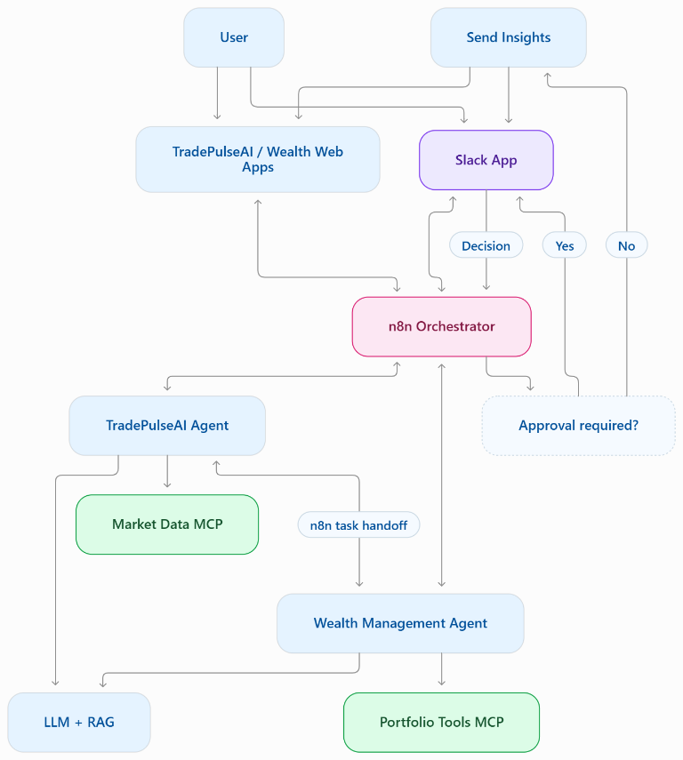
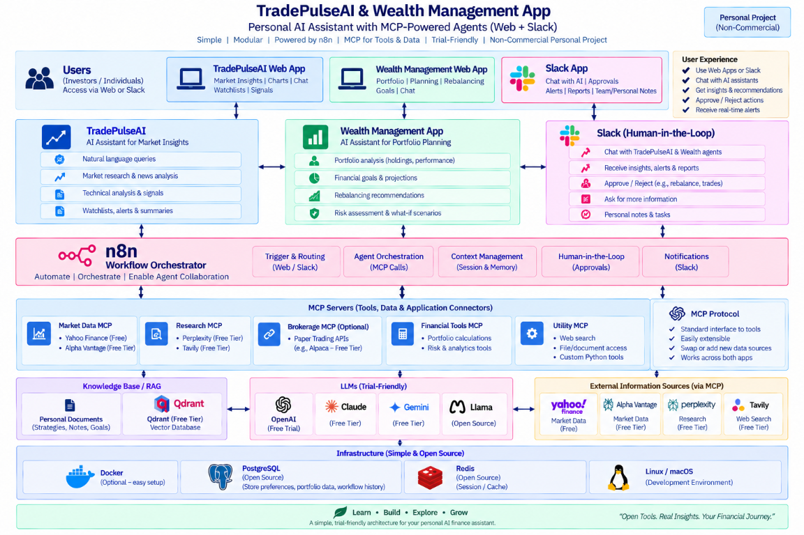

# RamGen Academy Learning

This repository contains multiple independent projects. Each project lives in
its own top-level directory and maintains its own setup instructions and
dependencies.

## Projects

| Project | Description |
| --- | --- |
| [TradePulse AI](./tradepulse-ai/README.md) | AI-powered trading analysis platform |
| [Wealth Management Planner](./wealth-management-app/README.md) | Portfolio and retirement planning application |

## Draft Architecture Diagrams

These diagrams are drafts for the TradePulse AI and Wealth Management
applications. Components and integrations are illustrative and may change.

### Agent Workflow and Human-in-the-Loop

### Personal AI Assistant Architecture

### Personal AI Assistant Architecture (Updated)

When adding a project, create a new top-level directory with a project-specific
README and keep its source, configuration, and dependencies within that
directory.
